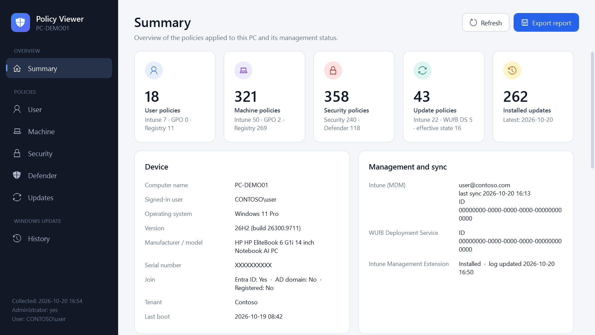
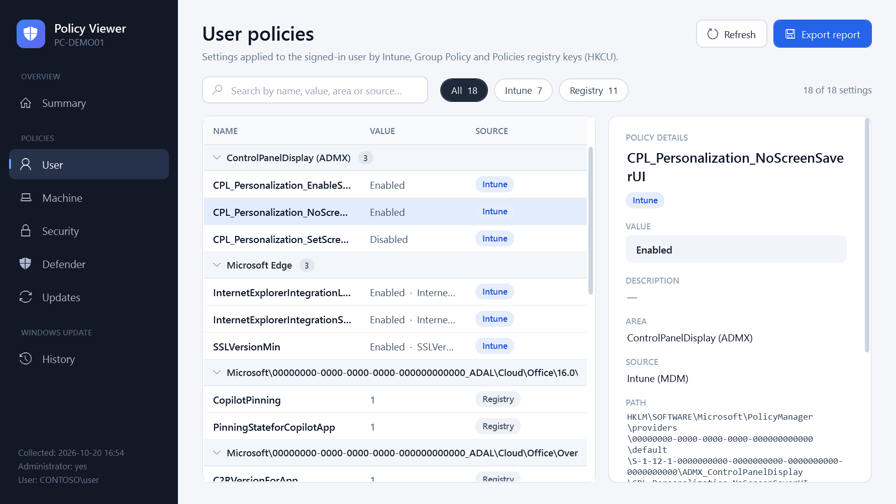
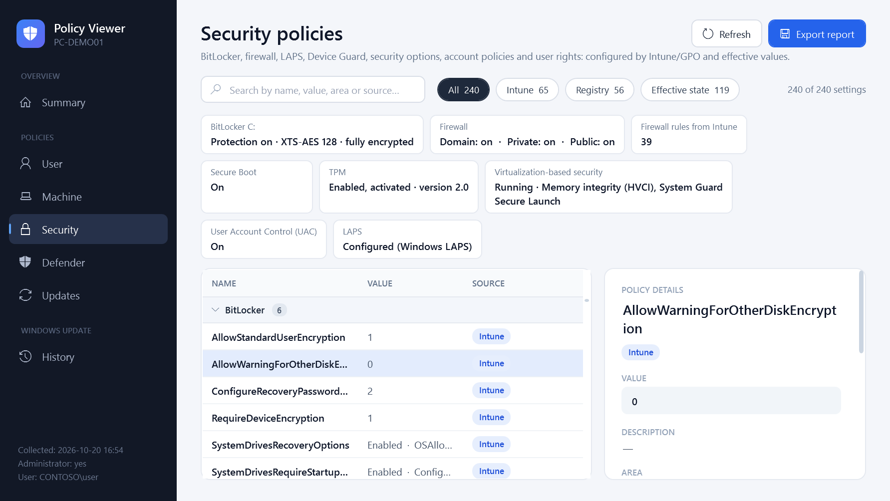
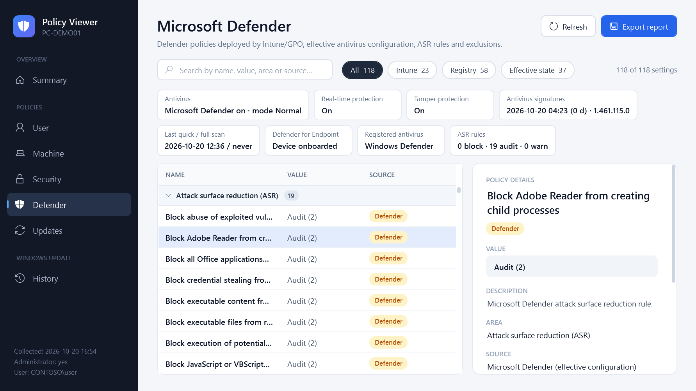
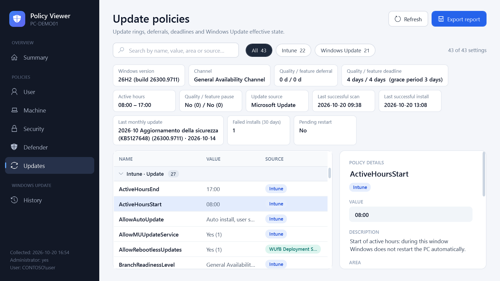
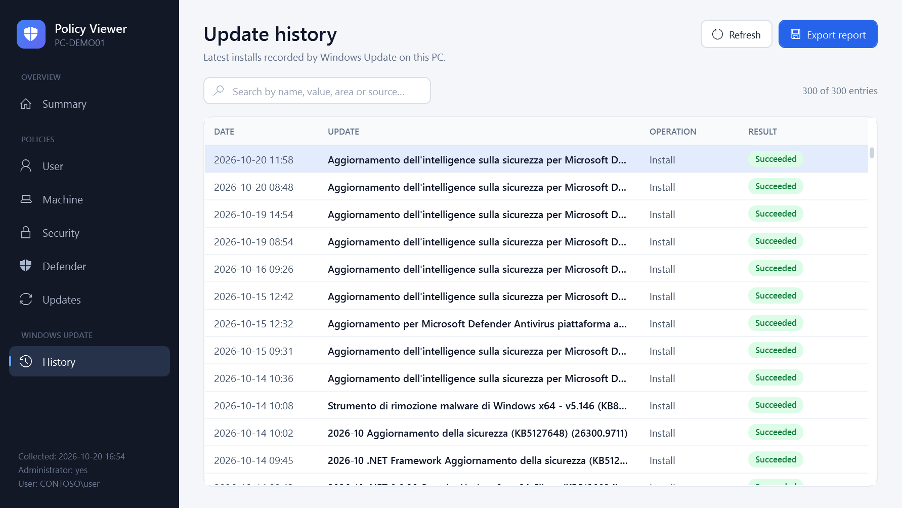

# Intune Policy Viewer

Windows application (single `.exe`, no installation) that shows the **name and details of the policies applied to the PC**, organized by section:

| Section | Content |
|---|---|
| **User** | Intune/MDM policies of the signed-in user, user GPOs, `HKCU\Software\Policies` keys |
| **Machine** | Intune/MDM device policies (CSP and ADMX: Edge, OneDrive, …), computer GPOs, `HKLM\SOFTWARE\Policies` keys |
| **Security** | BitLocker, firewall (including rules deployed by Intune), LAPS, Device Guard/VBS, Secure Boot, TPM, UAC, security options, account policies, audit policy and user rights (`secedit`, as administrator) |
| **Defender** | Defender policies from Intune/GPO, effective antivirus configuration, ASR rules by name, exclusions, status (real-time, tamper protection, signatures, Defender for Endpoint onboarding) |
| **Updates** | Update rings (deferrals, deadlines, active hours, channel), Windows Update for Business Deployment Service, effective state computed by Windows Update, WSUS/GPO policies |

Plus: device summary (Entra ID/AD join, tenant, last MDM sync), list of applied/filtered GPOs, **Windows Update history** and **HTML report export**.



For each setting the details panel shows the decoded value, a description (for Windows Update policies), area, source (Intune, GPO, registry, Windows Update, effective state), registry/CSP path, winning provider, allowed range and equivalent GPO key.

## Screenshots

Identifying data (PC, user, tenant, serial number, firewall rules) is anonymized with `--anonymize`.

| User policies | Security |
|---|---|
|  |  |
| **Microsoft Defender** | **Updates** |
|  |  |
| **Windows Update history** | |
|  | |

## Usage

Run `PolicyViewer.exe`.

- Works as a **standard user** too. As administrator it also shows computer GPOs (`gpresult /scope computer`) and local security policy; the *Restart as administrator* button appears on the summary when needed.
- If started with different credentials (e.g. an admin account), the user policies shown are those of the **user signed in to the session**.
- Search: `Ctrl+F`; refresh: `F5`. Source filters in the bar above the table.

Command line:

```
PolicyViewer.exe --export C:\Temp\report.html            # HTML report without UI (exit code 0 = ok)
PolicyViewer.exe --screenshot C:\Temp\shots              # test: saves one PNG per page and exits
PolicyViewer.exe --export C:\Temp\r.html --anonymize     # report/screenshots to share: hides PC, user, email, serial, tenant, IDs and firewall rules
```

> Note: **Intune profile names** (e.g. "Win11 - Update Ring") are not stored on the device: for MDM policies the CSP/ADMX setting name is shown, grouped by area.

## Data sources (read-only)

- `HKLM\SOFTWARE\Microsoft\PolicyManager\current` and `...\providers` – effective MDM policies and ADMX values
- `HKLM\SOFTWARE\Microsoft\Enrollments`, `...\Provisioning\OMADM\Accounts` – MDM enrollments and last sync
- `gpresult /x` – applied GPOs and their settings
- `HKLM`/`HKU\<SID>` `...\Policies` – effective policy values in the registry
- `SYSTEM\...\FirewallPolicy\Mdm` – firewall rules deployed by Intune
- WMI `MSFT_MpPreference` / `MSFT_MpComputerStatus` – effective Defender configuration, ASR rules, status
- `secedit /export` – local security policy (account, audit, user rights, security options)
- WMI BitLocker, TPM, Device Guard, firewall profiles – security status
- `HKLM\SOFTWARE\Microsoft\WindowsUpdate\UpdatePolicy\PolicyState` – Windows Update effective state
- COM API `Microsoft.Update.*` – history, last scan/install, default service
- `dsregcmd /status`, WMI – device information

The program changes nothing and sends no data over the network.

## Build

Requires only Windows with .NET Framework 4.8 (included in Windows 10/11): it uses the system C# compiler.

```powershell
.\src\build.ps1          # produces PolicyViewer.exe in the root folder
```

| File | Role |
|---|---|
| `src/Program.cs` | data collection, UI logic, HTML export |
| `src/MainWindow.xaml` | WPF interface (embedded in the exe as a resource) |
| `src/app.manifest` | `asInvoker`, per-monitor DPI |
| `src/app.ico` | icon (regenerated by `build.ps1` if missing) |
